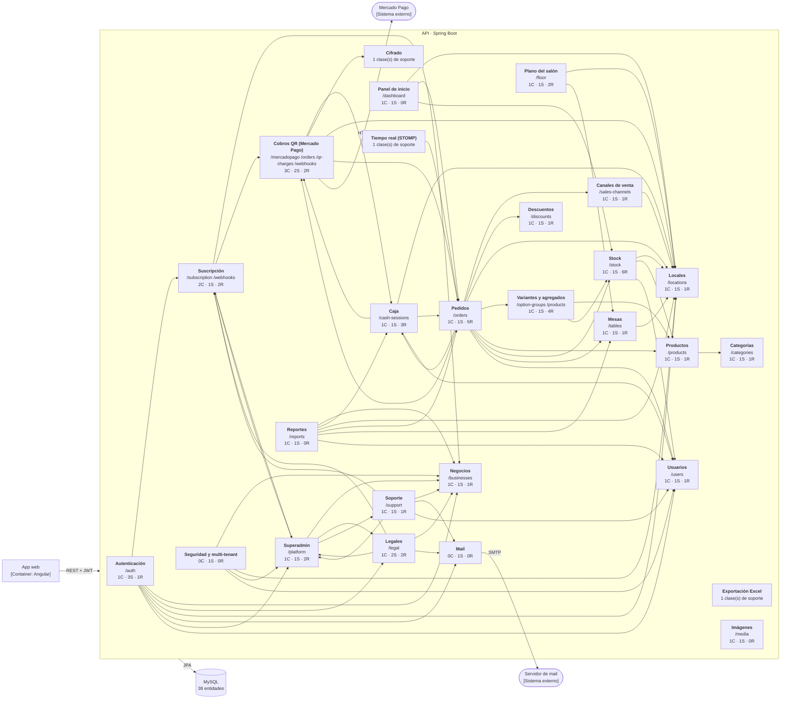

# C4 · Nivel 3 — Componentes de la API (Spring Boot)

Generado por la skill `arquitecto-c4` desde el commit `13d042b`. Cada componente es un paquete de `com.cofeapp.backend` (controller → service → repository); las flechas son dependencias reales entre paquetes (campos inyectados).

Seguridad y multi-tenant es transversal: la usan 12 componentes (Autenticación, Suscripción, Negocios, Caja, Legales, Cobros QR (Mercado Pago), Pedidos, Tiempo real (STOMP), Reportes, Stock, Soporte, Usuarios); esas flechas no se dibujan para que el diagrama se lea.

C = controllers, S = services, R = repositories. Detalle por paquete:

| Componente | Rutas | Controllers | Services | Repositories |
|---|---|---|---|---|
| Autenticación (`auth`) | /auth | AuthController | AuthService, LoginAttemptService, PasswordResetService | PasswordResetTokenRepository |
| Suscripción (`billing`) | /subscription, /webhooks | BillingWebhookController, SubscriptionController | BillingService | PlatformSettingsRepository, SubscriptionPaymentRepository |
| Negocios (`business`) | /businesses | BusinessController | BusinessService | BusinessRepository |
| Caja (`cash`) | /cash-sessions | CashSessionController | CashSessionService | CashMovementRepository, CashSessionDenominationRepository, CashSessionRepository |
| Categorías (`category`) | /categories | CategoryController | CategoryService | CategoryRepository |
| Canales de venta (`channel`) | /sales-channels | SalesChannelController | SalesChannelService | SalesChannelRepository |
| Cifrado (`crypto`) | — | — | — | — |
| Panel de inicio (`dashboard`) | /dashboard | DashboardController | DashboardService | — |
| Descuentos (`discount`) | /discounts | DiscountController | DiscountService | DiscountRepository |
| Exportación Excel (`excel`) | — | — | — | — |
| Plano del salón (`floor`) | /floor | FloorController | FloorService | FloorAreaRepository, FloorItemRepository |
| Legales (`legal`) | /legal | LegalController | LegalService, ServiceRequestService | LegalAcceptanceRepository, ServiceRequestRepository |
| Locales (`location`) | /locations | LocationController | LocationService | LocationRepository |
| Mail (`mail`) | — | — | MailService | — |
| Imágenes (`media`) | /media | MediaController | FileStorageService | — |
| Cobros QR (Mercado Pago) (`mercadopago`) | /mercadopago, /orders, /qr-charges, /webhooks | MercadoPagoController, MercadoPagoWebhookController, QrChargeController | MercadoPagoAccountService, QrChargeService | MercadoPagoAccountRepository, MpQrChargeRepository |
| Variantes y agregados (`option`) | /option-groups, /products | OptionGroupController | OptionGroupService | OptionGroupRepository, OptionItemRepository, OrderItemOptionRepository, ProductOptionGroupRepository |
| Pedidos (`order`) | /orders | OrderController | OrderService | OrderDiscountRepository, OrderItemRepository, OrderPaymentItemRepository, OrderPaymentRepository, OrderRepository |
| Superadmin (`platform`) | /platform | PlatformController | PlatformService | PlatformActionRepository, PlatformAdminRepository |
| Productos (`product`) | /products | ProductController | ProductService | ProductRepository |
| Tiempo real (STOMP) (`realtime`) | — | — | — | — |
| Reportes (`report`) | /reports | ReportController | ReportService | — |
| Seguridad y multi-tenant (`security`) | — | — | JwtService | — |
| Stock (`stock`) | /stock | StockController | StockService | IngredientRepository, IngredientStockAdjustmentRepository, IngredientStockRepository, ProductRecipeItemRepository, ProductStockAdjustmentRepository, ProductStockRepository |
| Soporte (`support`) | /support | SupportController | SupportService | SupportRequestRepository |
| Mesas (`table`) | /tables | TableController | TableService | TableRepository |
| Usuarios (`user`) | /users | UserController | UserService | UserRepository |
