# C4 · Nivel 3 — Componentes de la app web (Angular)

Generado por la skill `arquitecto-c4` desde el commit `174032e`. Pantallas (features) a la izquierda, services de `core/` a la derecha; las flechas salen de `inject()` / constructor.

```mermaid
flowchart LR
  subgraph Pantallas["Pantallas · features/"]
    f_account["account"]
    f_business["business"]
    f_cash["cash"]
    f_catalog["catalog"]
    f_dashboard["dashboard"]
    f_kds["kds"]
    f_legal["legal"]
    f_locations["locations"]
    f_login["login"]
    f_mercadopago["mercadopago"]
    f_password["password"]
    f_register["register"]
    f_reports["reports"]
    f_stock["stock"]
    f_superadmin["superadmin"]
    f_tables["tables"]
    f_users["users"]
    f_waiter["waiter"]
  end
  subgraph Servicios["Services · core/"]
    s_AuthService["AuthService<br/>/auth"]
    s_BusinessService["BusinessService<br/>/businesses /locations"]
    s_CashSessionService["CashSessionService<br/>/cash-sessions"]
    s_CategoryService["CategoryService<br/>/categories /products"]
    s_DashboardService["DashboardService<br/>/dashboard"]
    s_DiscountService["DiscountService<br/>/discounts"]
    s_LegalService["LegalService<br/>/legal"]
    s_MediaService["MediaService<br/>/media"]
    s_MercadoPagoService["MercadoPagoService<br/>/mercadopago /orders /qr-charges"]
    s_OfflineOrderQueueService["OfflineOrderQueueService<br/>cola local"]
    s_OptionGroupService["OptionGroupService<br/>/option-groups /products"]
    s_OrderService["OrderService<br/>/orders"]
    s_OrdersRealtimeService["OrdersRealtimeService<br/>STOMP"]
    s_PlatformService["PlatformService<br/>/platform"]
    s_ReportService["ReportService<br/>/reports"]
    s_StockService["StockService<br/>/stock"]
    s_TableService["TableService<br/>/tables"]
    s_UserService["UserService<br/>/users"]
    s_ui["Servicios de interfaz (6)"]
  end
  api["API<br/>[Container: Spring Boot]"]
  f_account --> s_AuthService
  f_account --> s_ui
  f_business --> s_AuthService
  f_business --> s_BusinessService
  f_business --> s_ui
  f_cash --> s_AuthService
  f_cash --> s_BusinessService
  f_cash --> s_CashSessionService
  f_cash --> s_ui
  f_catalog --> s_AuthService
  f_catalog --> s_CategoryService
  f_catalog --> s_DiscountService
  f_catalog --> s_MediaService
  f_catalog --> s_OptionGroupService
  f_catalog --> s_StockService
  f_catalog --> s_ui
  f_dashboard --> s_AuthService
  f_dashboard --> s_BusinessService
  f_dashboard --> s_CashSessionService
  f_dashboard --> s_CategoryService
  f_dashboard --> s_DashboardService
  f_dashboard --> s_TableService
  f_dashboard --> s_UserService
  f_kds --> s_AuthService
  f_kds --> s_OrderService
  f_kds --> s_OrdersRealtimeService
  f_kds --> s_TableService
  f_kds --> s_ui
  f_locations --> s_AuthService
  f_locations --> s_ui
  f_login --> s_AuthService
  f_login --> s_ui
  f_mercadopago --> s_MercadoPagoService
  f_mercadopago --> s_ui
  f_password --> s_AuthService
  f_password --> s_ui
  f_register --> s_AuthService
  f_register --> s_ui
  f_reports --> s_ReportService
  f_reports --> s_ui
  f_stock --> s_AuthService
  f_stock --> s_StockService
  f_stock --> s_ui
  f_superadmin --> s_AuthService
  f_superadmin --> s_PlatformService
  f_superadmin --> s_ui
  f_tables --> s_AuthService
  f_tables --> s_TableService
  f_tables --> s_ui
  f_users --> s_AuthService
  f_users --> s_UserService
  f_users --> s_ui
  f_waiter --> s_AuthService
  f_waiter --> s_CategoryService
  f_waiter --> s_OfflineOrderQueueService
  f_waiter --> s_OptionGroupService
  f_waiter --> s_OrderService
  f_waiter --> s_OrdersRealtimeService
  f_waiter --> s_TableService
  f_waiter --> s_ui
  s_AuthService -->|"HTTP"| api
  s_BusinessService -->|"HTTP"| api
  s_CashSessionService -->|"HTTP"| api
  s_CategoryService -->|"HTTP"| api
  s_DashboardService -->|"HTTP"| api
  s_DiscountService -->|"HTTP"| api
  s_LegalService -->|"HTTP"| api
  s_MediaService -->|"HTTP"| api
  s_MercadoPagoService -->|"HTTP"| api
  s_OfflineOrderQueueService -.-> s_OrderService
  s_OptionGroupService -->|"HTTP"| api
  s_OrderService -->|"HTTP"| api
  s_OrdersRealtimeService -->|"STOMP"| api
  s_PlatformService -->|"HTTP"| api
  s_ReportService -->|"HTTP"| api
  s_StockService -->|"HTTP"| api
  s_TableService -->|"HTTP"| api
  s_UserService -->|"HTTP"| api
```

| Service | Tipo | Rutas de la API |
|---|---|---|
| ApiService | api | — |
| AuthService | http | /auth |
| BusinessService | http | /businesses, /locations |
| CashSessionService | http | /cash-sessions |
| CategoryService | http | /categories, /products |
| DashboardService | http | /dashboard |
| DiscountService | http | /discounts |
| LayoutService | ui | — |
| LegalService | http | /legal |
| LocationResolverService | ui | — |
| MediaService | http | /media |
| MercadoPagoService | http | /mercadopago, /orders, /qr-charges |
| OfflineOrderQueueService | offline | — |
| OptionGroupService | http | /option-groups, /products |
| OrderService | http | /orders |
| OrdersRealtimeService | realtime | — |
| PlatformService | http | /platform |
| PrintContextService | ui | — |
| ReportService | http | /reports |
| StockService | http | /stock |
| TableService | http | /tables |
| ThemeService | ui | — |
| TicketPrintService | ui | — |
| ToastService | ui | — |
| UserService | http | /users |
