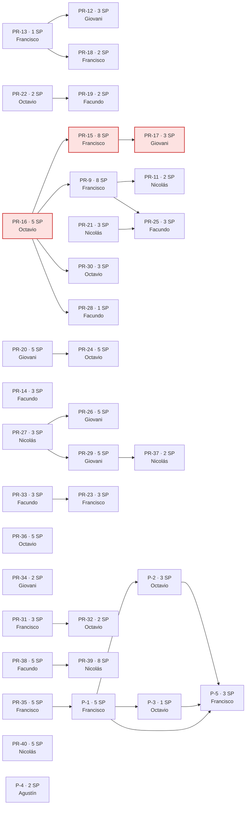

# Análisis de Ley de Brooks — Semana 44

> "Agregar gente a un proyecto atrasado lo atrasa más." — Fred Brooks, *The Mythical Man-Month* (1975)

## Diagnóstico
🟡 **Riesgo** — 60% del trabajo pendiente es secuencial o crítico de conocimiento.

## Equipo y comunicación
- Integrantes del grupo del TP: 2 (Francisco, Octavio) — canales: 1 — overhead estimado: no medible (no hay tareas de reunión en el tablero)
- Personas que trabajaron en el repo/tablero esta semana: 5 (Facundo, Francisco, Giovani, Nicolás, Octavio) — canales: 10
- Fórmula: canales = n × (n − 1) ÷ 2. Con +1 persona en el grupo del TP: 3 canales; con +2: 6.

## Trabajo pendiente
| Historia | Puntos | Paralelizable / Secuencial / Crítica | Depende de | Quién sabe |
|---|---|---|---|---|
| PR-16 — La caja abre, cobra, registra movimientos y cierra con conteo | 5 | Paralelizable | — | Nicolás, Facundo |
| PR-15 — El cliente paga con QR de Mercado Pago | 8 | Secuencial | PR-16 | Nicolás, Facundo |
| PR-13 — El dueño ve el resumen del día apenas entra | 1 | Paralelizable | — | Nicolás, Facundo |
| PR-12 — Cada rol ve un inicio con sus números clave (KPIs) | 3 | Secuencial | PR-13 | Octavio, Facundo |
| PR-19 — El usuario cambia o recupera su contraseña sin pedir ayuda | 2 | Secuencial | PR-22 | Octavio, Facundo |
| PR-18 — El dueño consulta reportes de ventas en pantalla | 2 | Secuencial | PR-13 | Octavio, Facundo |
| PR-9 — El cajero cobra un pedido desde la pantalla de caja | 8 | Secuencial | PR-16 | Octavio, Facundo |
| PR-21 — El café aplica descuentos a un ítem o a todo el pedido | 3 | Paralelizable | — | Nicolás, Facundo |
| PR-11 — Se imprimen comanda, ticket y cierre de caja desde el navegador | 2 | Secuencial | PR-9 | Octavio, Facundo |
| PR-22 — Las cuentas están protegidas: recuperar contraseña, bloqueo por intentos y cierre de sesiones | 2 | Paralelizable | — | Nicolás, Facundo |
| PR-20 — Un producto tiene variantes y agregados (tamaño, leche, extra shot) | 5 | Paralelizable | — | Nicolás, Facundo |
| PR-17 — El dueño conecta su cuenta de Mercado Pago para cobrar con QR | 3 | Secuencial | PR-15 | Octavio, Facundo |
| PR-14 — El encargado controla insumos y stock desde la web | 3 | Paralelizable | — | Octavio, Facundo |
| PR-26 — La plataforma ve todos los cafés clientes y los activa o suspende (panel superadmin) | 5 | Secuencial | PR-27 | Octavio, Facundo |
| PR-24 — El mozo elige variantes y agregados al cargar el pedido | 5 | Secuencial | PR-20 | Octavio, Facundo |
| PR-23 — Términos y política de privacidad visibles para cualquiera | 3 | Secuencial | PR-33 | Octavio, Facundo |
| PR-29 — Cada café paga su suscripción mensual con débito automático | 5 | Secuencial | PR-27 | Nicolás, Facundo |
| PR-30 — El contador recibe un Excel con ventas y cierres de caja | 3 | Secuencial | PR-16 | Nicolás, Facundo |
| PR-25 — El cajero aplica descuentos desde una lista armada | 3 | Secuencial | PR-21, PR-9 | Octavio, Facundo |
| PR-31 — Los pedidos de apps de delivery se cargan en modo manual | 3 | Paralelizable | — | Nicolás, Facundo |
| PR-32 — El dueño elige qué apps de delivery usa cada local | 2 | Secuencial | PR-31 | Octavio, Facundo |
| PR-28 — La mesa divide la cuenta en partes iguales o por productos | 1 | Secuencial | PR-16 | Nicolás, Facundo |
| PR-35 — La app está lista para instalarse en un servidor (Docker, HTTPS, backups) | 5 | Paralelizable | — | Francisco |
| PR-37 — El café ve el estado de su suscripción y la paga desde la app | 2 | Secuencial | PR-29 | Octavio, Facundo |
| PR-36 — Probamos todo antes de salir: barrido de endpoints, carga y concurrencia | 5 | Paralelizable | — | Octavio |
| PR-34 — Un usuario nuevo aprende la app con un tour guiado | 2 | Paralelizable | — | Octavio, Facundo |
| PR-33 — El sistema cumple con términos, privacidad y botón de arrepentimiento/baja | 3 | Paralelizable | — | Nicolás, Facundo |
| PR-39 — El dueño dibuja el plano del salón y pide soporte con un botón | 8 | Secuencial | PR-38 | Octavio, Facundo |
| PR-38 — El salón se organiza por zonas y el café puede pedir soporte | 5 | Paralelizable | — | Nicolás, Facundo |
| PR-27 — La plataforma administra cafés clientes y planes (superadmin) | 3 | Paralelizable | — | Nicolás, Facundo |
| PR-40 — Cualquiera del equipo entiende el proyecto leyendo el README | 5 | Paralelizable | — | Nicolás |
| P-1 — Un café piloto entra a la app desde internet con HTTPS | 5 | Secuencial | PR-35 | Francisco |
| P-2 — Las copias nocturnas se restauran bien (prueba real de restauración) | 3 | Secuencial | P-1 | Octavio |
| P-3 — Nos avisa al celular si la app se cae (monitor sobre /actuator/health) | 1 | Secuencial | P-1 | Octavio |
| P-4 — Términos y privacidad con los datos reales del responsable | 2 | Paralelizable | — | Agustín |
| P-5 — 1 o 2 cafés de Mar del Plata usan la app gratis un mes como piloto | 3 | Secuencial | P-1, P-2, P-3 | Francisco |

- Pendiente comprometido: **129 SP** — paralelizable 52 SP, secuencial o crítico 77 SP.
- Ruta crítica: PR-16 → PR-15 → PR-17 (16 pts, ~0.9 semanas a 18.0 SP/semana por persona) — piso mínimo del proyecto.
- Dependencias: las del tablero (campo «Depende de» de cada ticket); las de los tickets reconstruidos se infirieron de git y de los títulos.
- Fuera del alcance comprometido (deseable): P-6 (8 SP), P-7 (13 SP).

## Cuellos de botella y bus factor
| Carpeta | Bus factor | Quién la conoce (más de la mitad de las líneas) |
|---|---|---|
| backend/ | 2 | Nicolás, Facundo |
| frontend/ | 2 | Octavio, Facundo |

- Revisiones (merges de PR) acumuladas: Francisco 4, Facundo 2, Nicolás 2, Giovani 1. Francisco mergea el 44%: si falta, los PRs esperan.
- Octavio tiene 7 tarea(s) pendiente(s) que esperan algo suyo.
- Francisco tiene 10 tarea(s) pendiente(s) que esperan algo suyo.
- Nicolás tiene 3 tarea(s) pendiente(s) que esperan algo suyo.
- Giovani tiene 2 tarea(s) pendiente(s) que esperan algo suyo.
- Facundo tiene 2 tarea(s) pendiente(s) que esperan algo suyo.

## Simulación: ¿sumar gente?
Base: grupo del TP con 2 desarrolladores a 18.0 SP/semana cada uno (velocidad del grupo 36.0 SP/semana, promedio de las semanas 44). Quedan 6.1 semanas hasta la entrega final (2026-12-14).

| Escenario | Personas | Canales | Capacidad efectiva sem 1–4 (SP) | Fin estimado | vs. hoy |
|---|---|---|---|---|---|
| Equipo actual | 2 | 1 | 36.0 / 36.0 / 36.0 / 36.0 | 27/11/2026 (3.6 sem.) | — |
| +1 persona(s) | 3 | 3 | 33.2 / 37.3 / 44.5 / 48.6 | 25/11/2026 (3.3 sem.) | acorta (-0.3 sem.) |
| +2 persona(s) | 4 | 6 | 28.4 / 35.1 / 47.2 / 38.5 | 26/11/2026 (3.5 sem.) | no cambia (-0.1 sem.) |

## Recomendaciones
- **Bajar el cuello de botella de revisión**: que cualquiera del grupo pueda mergear con una aprobación, en vez de depender de una sola persona.
- Si igual hace falta alguien, conviene **un colaborador que ya conoce el código** (Gio, Facu o Nico): no tiene rampa ni necesita mentor, a diferencia de una persona nueva. Solo en tareas paralelizables.

## Supuestos
- Productividad de una persona nueva: 25 % / 50 % / 75 % / 100 % en sus semanas 1 a 4.
- Mentoría: 20 % del tiempo de un integrante durante las primeras 2 semanas.
- Overhead: 5 % menos de productividad del equipo por cada canal nuevo.
- La persona nueva solo toma trabajo paralelizable.
- Velocidad = SP cerrados por el grupo del TP; Agustín (PO) cuenta para la comunicación pero no suma SP de código.
- «Quién sabe» y bus factor salen de las líneas agregadas por autor en cada carpeta (git log de main).
- Fuente: gestion/plane/tickets.json (tablero reconstruido desde git).
