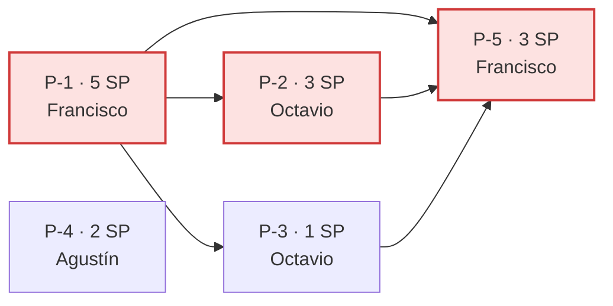

# Análisis de Ley de Brooks — Semana 46

> "Agregar gente a un proyecto atrasado lo atrasa más." — Fred Brooks, *The Mythical Man-Month* (1975)

## Diagnóstico
🟡 **Riesgo** — 86% del trabajo pendiente es secuencial o crítico de conocimiento.

## Equipo y comunicación
- Integrantes del grupo del TP: 2 (Francisco, Octavio) — canales: 1 — overhead estimado: no medible (no hay tareas de reunión en el tablero)
- Personas que trabajaron en el repo/tablero esta semana: 5 (Facundo, Francisco, Giovani, Nicolás, Octavio) — canales: 10
- Fórmula: canales = n × (n − 1) ÷ 2. Con +1 persona en el grupo del TP: 3 canales; con +2: 6.

## Trabajo pendiente
| Historia | Puntos | Paralelizable / Secuencial / Crítica | Depende de | Quién sabe |
|---|---|---|---|---|
| P-1 — Un café piloto entra a la app desde internet con HTTPS | 5 | Crítica de conocimiento | — | Francisco |
| P-2 — Las copias nocturnas se restauran bien (prueba real de restauración) | 3 | Secuencial | P-1 | Francisco |
| P-3 — Nos avisa al celular si la app se cae (monitor sobre /actuator/health) | 1 | Secuencial | P-1 | Francisco |
| P-4 — Términos y privacidad con los datos reales del responsable | 2 | Paralelizable | — | Agustín |
| P-5 — 1 o 2 cafés de Mar del Plata usan la app gratis un mes como piloto | 3 | Secuencial | P-1, P-2, P-3 | Francisco |

- Pendiente comprometido: **14 SP** — paralelizable 2 SP, secuencial o crítico 12 SP.
- Ruta crítica: P-1 → P-2 → P-5 (11 pts, ~0.8 semanas a 14.7 SP/semana por persona) — piso mínimo del proyecto.
- Dependencias: las del tablero (campo «Depende de» de cada ticket); las de los tickets reconstruidos se infirieron de git y de los títulos.
- Fuera del alcance comprometido (deseable): P-6 (8 SP), P-7 (13 SP).

## Cuellos de botella y bus factor
| Carpeta | Bus factor | Quién la conoce (más de la mitad de las líneas) |
|---|---|---|
| backend/ | 2 | Nicolás, Facundo |
| deploy/ | 1 ⚠️ | Francisco |
| docs/pruebas/ | 1 ⚠️ | Octavio |
| frontend/ | 2 | Octavio, Facundo |

- Revisiones (merges de PR) acumuladas: Francisco 11, Giovani 9, Nicolás 8, Facundo 7, Octavio 5. Francisco mergea el 28%: si falta, los PRs esperan.
- Francisco tiene 3 tarea(s) pendiente(s) que esperan algo suyo.
- Octavio tiene 2 tarea(s) pendiente(s) que esperan algo suyo.

## Simulación: ¿sumar gente?
Base: grupo del TP con 2 desarrolladores a 14.7 SP/semana cada uno (velocidad del grupo 29.3 SP/semana, promedio de las semanas 44, 45, 46). Quedan 4.1 semanas hasta la entrega final (2026-12-14).

| Escenario | Personas | Canales | Capacidad efectiva sem 1–4 (SP) | Fin estimado | vs. hoy |
|---|---|---|---|---|---|
| Equipo actual | 2 | 1 | 29.3 | 20/11/2026 (0.5 sem.) | — |
| +1 persona(s) | 3 | 3 | 25.8 | 20/11/2026 (0.5 sem.) | no cambia (+0.0 sem.) |
| +2 persona(s) | 4 | 6 | 19.6 | 21/11/2026 (0.7 sem.) | no cambia (+0.2 sem.) |

## Recomendaciones
- **Reducir bus factor** en deploy/, docs/pruebas/: pair programming o revisión cruzada (que Octavio acompañe a Francisco en el despliegue, por ejemplo).
- **Bajar el cuello de botella de revisión**: que cualquiera del grupo pueda mergear con una aprobación, en vez de depender de una sola persona.
- Si igual hace falta alguien, conviene **un colaborador que ya conoce el código** (Gio, Facu o Nico): no tiene rampa ni necesita mentor, a diferencia de una persona nueva. Solo en tareas paralelizables.

## Supuestos
- Productividad de una persona nueva: 25 % / 50 % / 75 % / 100 % en sus semanas 1 a 4.
- Mentoría: 20 % del tiempo de un integrante durante las primeras 2 semanas.
- Overhead: 5 % menos de productividad del equipo por cada canal nuevo.
- La persona nueva solo toma trabajo paralelizable.
- Velocidad = SP cerrados por el grupo del TP; Agustín (PO) cuenta para la comunicación pero no suma SP de código.
- «Quién sabe» y bus factor salen de las líneas agregadas por autor en cada carpeta (git log de main).
- Fuente: gestion/plane/tickets.json (tablero reconstruido desde git).
